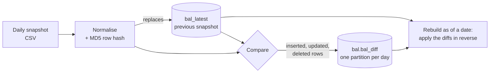

# Incremental Storage of French Address Snapshots with Apache Spark

A Spark batch pipeline in Java that ingests daily full snapshots of the French national address base (BAN / BAL), stores only the day-to-day differences, and can rebuild the complete dataset as of any past date.
Differences are reversible (old and new row kept as JSON), so one full snapshot plus the partitioned diff table replace one full copy per day.

Data engineering course project, ESILV, January 2026. Author: Sami Chellia.

## Methodology



1. **Normalisation.** Column names are cleaned, every column is cast to string, rows without identifier are dropped and identifiers are de-duplicated. The identifier is `id`, with fallbacks `cle_interop`, `uid_adresse` and `id_ban`.
2. **Row signature.** An MD5 hash of all non-identifier columns, taken in sorted column order, is stored next to each row.
3. **Daily diff.** The new snapshot is compared with the previous one (`bal_latest`):
   - inserted rows: left anti join of new on previous identifiers;
   - deleted rows: left anti join of previous on new identifiers;
   - updated rows: inner join on the identifier, filtered on different hashes.
4. **Storage.** Diffs go to the Hive table `bal.bal_diff`, in Parquet, partitioned by day, with columns `op` (`I`, `U`, `D`), `id`, `old_json`, `new_json`, `old_hash`, `new_hash`. `bal_latest` is then replaced by the new snapshot.
5. **As-of recompute.** Starting from `bal_latest`, the diffs of every day after the requested date are applied in reverse: inserted rows are removed, updated and deleted rows are restored from `old_json`.
6. **Unchanged input (optional).** A fingerprint of the input file (path, size, modification time) lets the job write an empty partition without reading the snapshot again.

| Command | Script |
|---|---|
| Integrate one daily snapshot | `scripts/run_daily_file_integration.sh <date> <csv file or directory>` |
| Totals per department and last diff | `scripts/run_report.sh` |
| Rebuild the dataset as of a date | `scripts/recompute_and_extract_dump_at_date.sh <date> <output directory>` |
| Compare two Parquet datasets | `scripts/compute_diff_between_files.sh <directory 1> <directory 2>` |

## Results

**National snapshot (local mode, one machine).**

| Measure | Value |
|---|---|
| Input file | `adresses-france.csv`, 6.7 GB |
| Addresses loaded on the first day | 26,276,705 |
| Daily integrations recorded | 50 (2025-01-02 to 2025-02-20) |
| As-of recompute | 27 days reverse-applied |
| Diff between two recomputed dumps | 0 inserted, 0 updated, 0 deleted |

In this run every day after the first received the same snapshot file, so only the first-day load and the unchanged-input path were exercised at full scale. Run times were not recorded.

**Sample data (`scripts/smoke_test.sh`).** Three small snapshots with known changes:

| Day | Previous | New | Inserted | Updated | Deleted |
|---|---|---|---|---|---|
| 2025-01-02 | 0 | 4 | 4 | 0 | 0 |
| 2025-01-03 | 4 | 4 | 1 | 1 | 1 |
| 2025-01-04 | 4 | 4 | 0 | 1 | 0 |

The dataset rebuilt as of 2025-01-02 from the two later diffs is identical to a direct load of the first snapshot (0 inserted, 0 updated, 0 deleted).

### Limitations

- The insert, update and delete paths are checked on the sample data only.
- `bal_latest` and each daily diff are written as a single Parquet file, which suits one machine, not a cluster.
- No JUnit tests; the end-to-end script is the only functional check (the CI workflow only builds the jar).

## Project structure

```
├── pom.xml
├── src/main/java/fr/esilv/
│   ├── SparkMain.java               command-line entry point
│   ├── jobs/DailyIntegrationJob.java  daily diff and storage
│   ├── jobs/RecomputeJob.java       as-of rebuild
│   ├── jobs/DiffJob.java            diff between two datasets
│   ├── jobs/ReportJob.java          totals per department
│   └── util/                        normalisation, hashing, Spark session, paths
├── scripts/                         launchers and end-to-end test
└── examples/                        three fictional snapshots
```

## Quickstart

Requirements: JDK 17, Maven, and Apache Spark with `spark-submit` on the `PATH`. The project is built against Spark 3.5.1; the end-to-end test was also run with Spark 4.0.1.

```bash
git clone https://github.com/samichellia90-bit/bal-spark-incremental-pipeline.git
cd bal-spark-incremental-pipeline
mvn clean package
bash scripts/smoke_test.sh         # prints SMOKE TEST OK
```

On Windows, run the scripts from Git Bash, set `HADOOP_HOME` and put the folder that contains `winutils.exe` and `hadoop.dll` on the `PATH`.

Real data: download a national snapshot from [adresse.data.gouv.fr](https://adresse.data.gouv.fr/donnees-nationales) (Licence Ouverte 2.0), then:

```bash
scripts/run_daily_file_integration.sh 2025-01-02 /data/dump-2025-01-02/adresses-france.csv
scripts/run_report.sh
scripts/recompute_and_extract_dump_at_date.sh 2025-01-02 /tmp/dump_as_of
scripts/compute_diff_between_files.sh /tmp/dump_a /tmp/dump_b
```

| Setting | Role |
|---|---|
| `BAL_STORAGE_ROOT` or `-Dbal.storage.root` | Folder of `bal.db/`, `bal_latest/` and the metastore (default: current directory) |
| `BAL_SKIP_IF_SAME_INPUT` | Set to `1` to enable the unchanged-input shortcut (off by default) |
| `BAL_RECOMPUTE_SINGLE_FILE` | Set to `0` to write the recomputed dump as several Parquet files (one file by default) |
| `SPARK_MASTER` | Spark master URL (default `local[*]`) |

## Output layout

```
bal.db/bal_diff/day=2025-01-02/part-*.parquet
bal.db/bal_diff/day=2025-01-03/part-*.parquet
bal_latest/part-*.parquet
```

The CSV separator is `;` and the encoding is UTF-8. The address snapshots are not redistributed here; the files in `examples/` are fictional.

## License

MIT. See [LICENSE](LICENSE).
